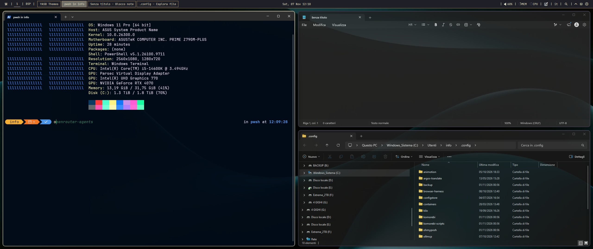
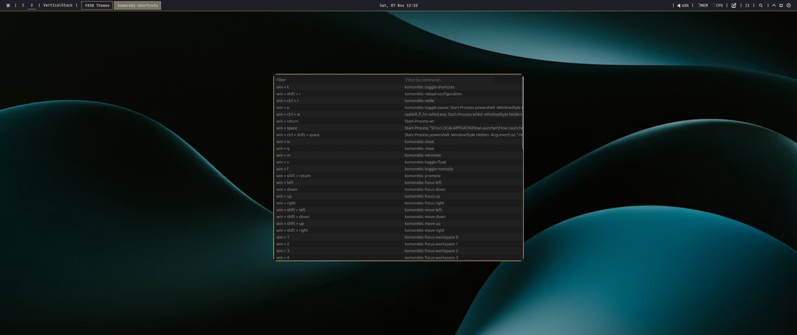

# Windowsarchy Full

Windowsarchy Full is the same bar as Windowsarchy Lite plus the parts that make it a complete setup, inspired by Omarchy (not affiliated with it).

- Left click on the Wi-Fi widget opens a floating Wi-Fi panel (networks, connect, QR code, speed test).
- Komorebi start/reload re-attaches YASB if the bar is left on "Komorebi Offline".
- Every shortcut lives on the Win key; Win+K shows the cheatsheet.
- Win+Ctrl+Shift+Space opens a theme menu that changes bar, window borders and launcher together.
- Optional system equalizer through Equalizer APO.

All extra files, with install steps, are in https://github.com/Limestudio90/Windowsarchy_public. Without them the Wi-Fi left click and the re-attach command do nothing; use Windowsarchy Lite for a standalone version.

## Widgets

- Home
- Custom
- Komorebi Workspaces
- Komorebi Layout
- Taskbar
- Clock
- Media
- Volume
- Memory
- CPU
- Notes
- Language
- Quick Launch
- Systray
- WiFi
- Notifications
- Power Menu

## Requirements

- Segoe Fluent Icons
- [JetBrainsMono Nerd Font Propo](https://www.nerdfonts.com/font-downloads)
- [Komorebi](https://github.com/LGUG2Z/komorebi)
- [whkd](https://github.com/LGUG2Z/whkd)
- [Windowsarchy setup repo (scripts, whkdrc, themes)](https://github.com/Limestudio90/Windowsarchy_public)
- [Python 3.10+](https://www.python.org/downloads/) with PyQt6, psutil, qrcode, winrt (Wi-Fi panel)
- [winfetch](https://github.com/lptstr/winfetch) and [Oh My Posh](https://ohmyposh.dev) (optional, terminal look shown in the previews)
- [Windows Terminal](https://github.com/microsoft/terminal) (optional)
- [Flow Launcher](https://github.com/Flow-Launcher/Flow.Launcher) (optional)
- [Equalizer APO](https://sourceforge.net/projects/equalizerapo/) (optional)

## Screenshots

