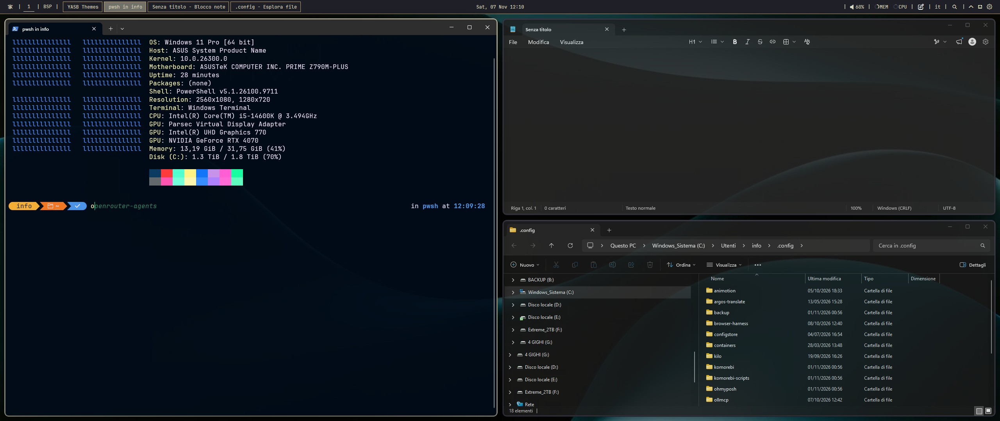

# Windowsarchy Lite

Windowsarchy Lite is a clean top bar inspired by the Omarchy desktop on Linux (not affiliated with it). It is built around Komorebi: workspaces I-VII, the active layout and a taskbar on the left, the clock in the center, and media, volume, memory, CPU, notes, language, quick launch, tray, Wi-Fi, notifications and power menu on the right.

Colors follow a dark Kanagawa-like palette with thin separators and rounded hover states. Everything works with the stock YASB widgets: the Wi-Fi widget opens the built-in YASB menu and Komorebi starts with the default commands.

A heavier variant with a custom Wi-Fi panel, theme switcher and global shortcuts is available as "Windowsarchy Full".

## Widgets

- Home
- Custom
- Komorebi Workspaces
- Komorebi Layout
- Taskbar
- Clock
- Media
- Volume
- Memory
- CPU
- Notes
- Language
- Quick Launch
- Systray
- WiFi
- Notifications
- Power Menu

## Requirements

- Segoe Fluent Icons
- [JetBrainsMono Nerd Font Propo](https://www.nerdfonts.com/font-downloads)
- [Komorebi](https://github.com/LGUG2Z/komorebi)
- [whkd](https://github.com/LGUG2Z/whkd)

## Screenshots

