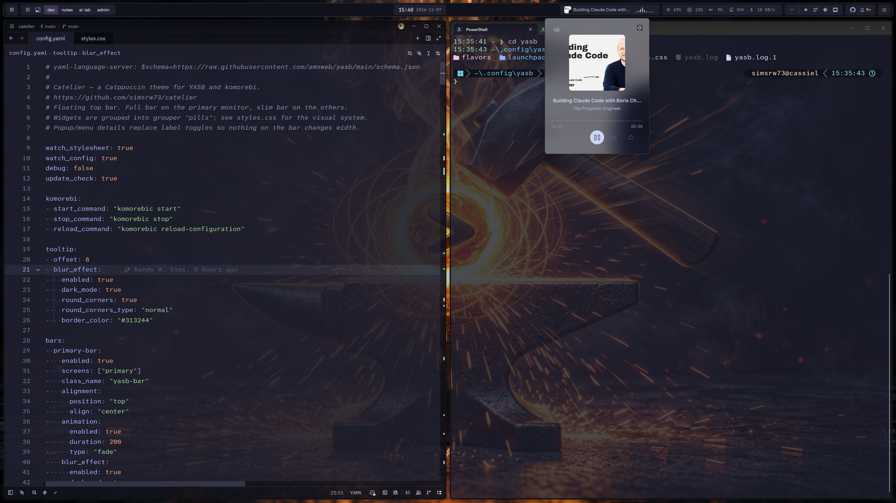
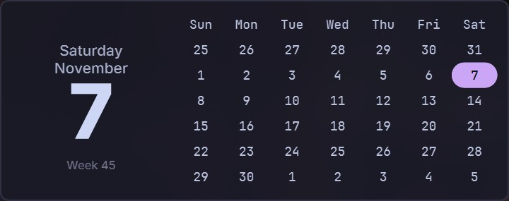
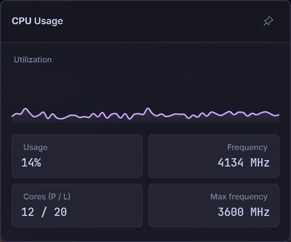

# Catelier Lite

Catelier is a quiet command center: compact, orderly, and information-rich, with enough restraint to stay out of your way while you work. Important information is brighter and heavier so it catches your eye, while less important information is quieter so that it recedes into the background. Similar information and controls are grouped for easier scanning and access. Color only marks state: mauve for focus, peach when something is waiting for you, like GitHub notifications, and red for a critical reading or the power button. The palette is from Catppuccin Mocha.

Numbers use a monospace font with fixed widths, so the bar doesn't shift as values change. Details open in popups, and the labels on the bar stay the same. The calendar, system stats, network, disk, Wi-Fi, Bluetooth, volume, media, control center, GitHub, tray and power popups all share the same surfaces, spacing and buttons.

Other monitors get a slim bar with the launcher, workspaces, window title and clock.

Catelier Lite is the gallery version of [Catelier](https://github.com/simsrw73/catelier). The full version on GitHub adds Latte, Frappé and Macchiato (Latte is adjusted for contrast on a light background), a choice of any of the 14 Catppuccin accents, optional translucency, a drive health widget and GlazeWM support. Its README has a one-line PowerShell install.

The name is Catppuccin plus *atelier*, French for an artist's studio.

## Widgets

- Launchpad
- Komorebi Control
- Komorebi Layout
- Komorebi Stack
- Komorebi Workspaces
- Active Window
- Clock
- Media Lite
- Audio Visualizer
- Memory
- CPU
- GPU
- Disk
- Traffic
- Systray
- Volume
- Control Center
- Bluetooth
- WiFi
- GitHub
- Notifications
- Power Menu

## Requirements

- Segoe Fluent Icons
- [JetBrainsMono Nerd Font](https://www.nerdfonts.com/font-download) (Included with YASB)
- [Komorebi](https://github.com/LGUG2Z/komorebi) or [GlazeWM](https://github.com/glzr-io/glazewm)

## Screenshots

